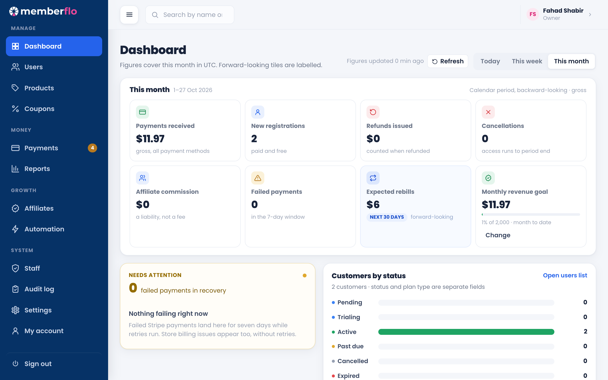
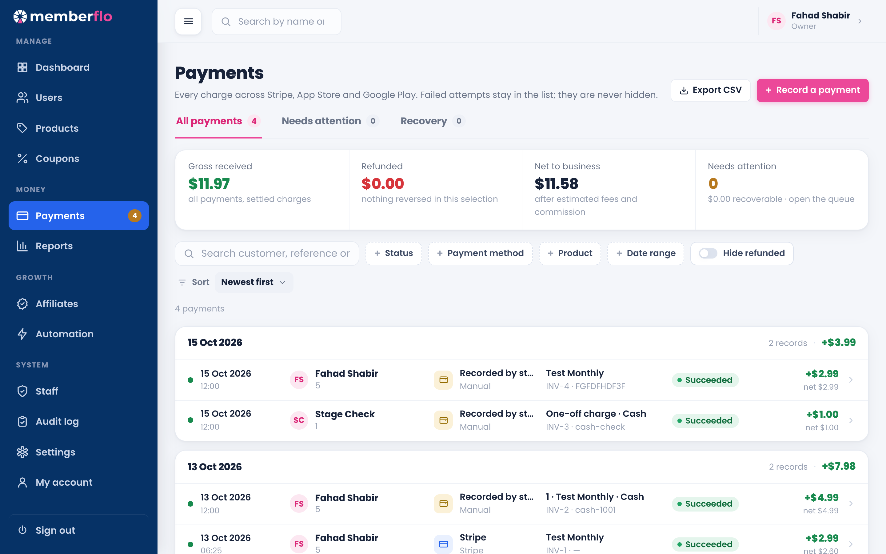
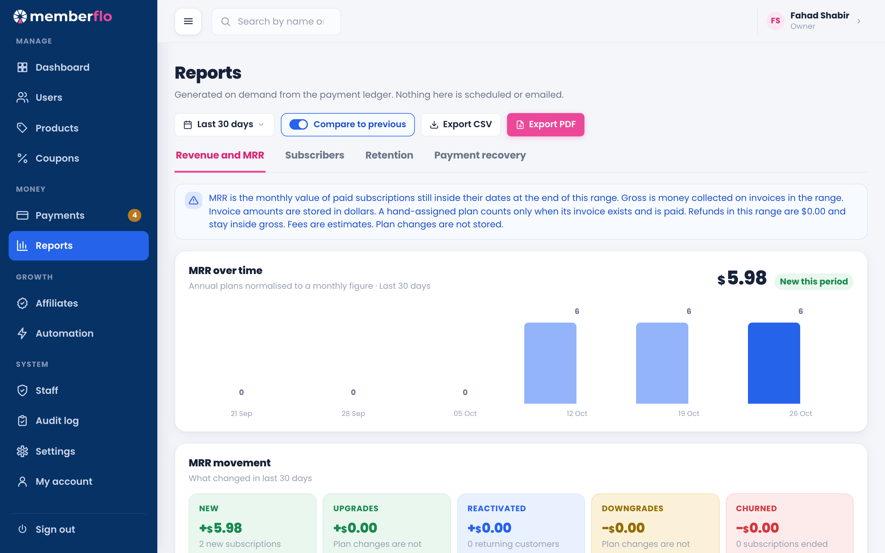
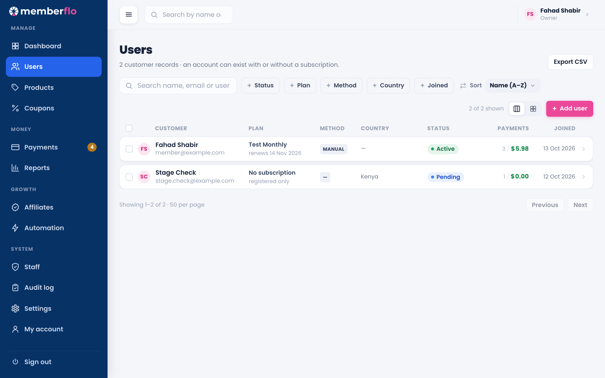
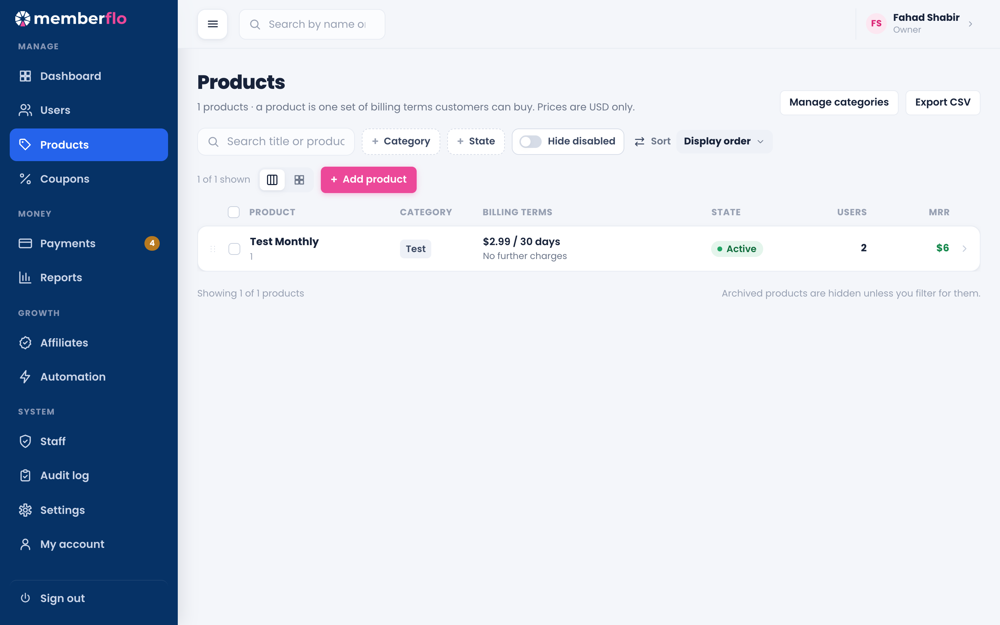
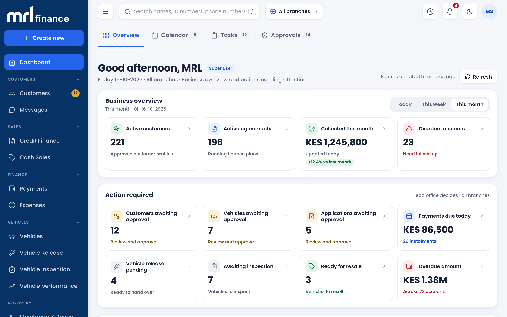
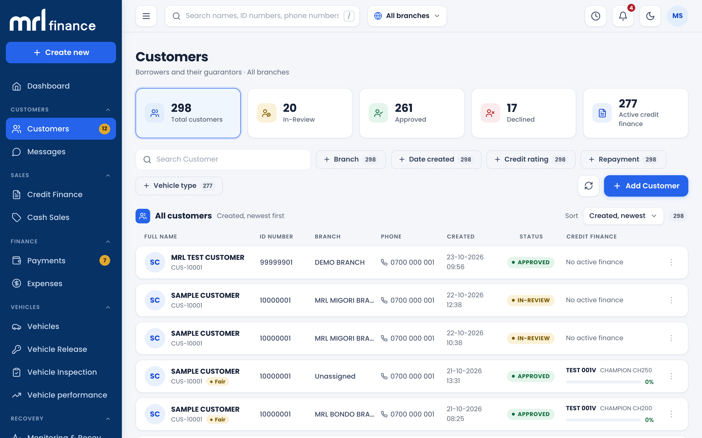
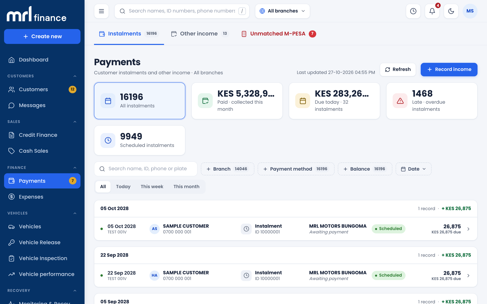
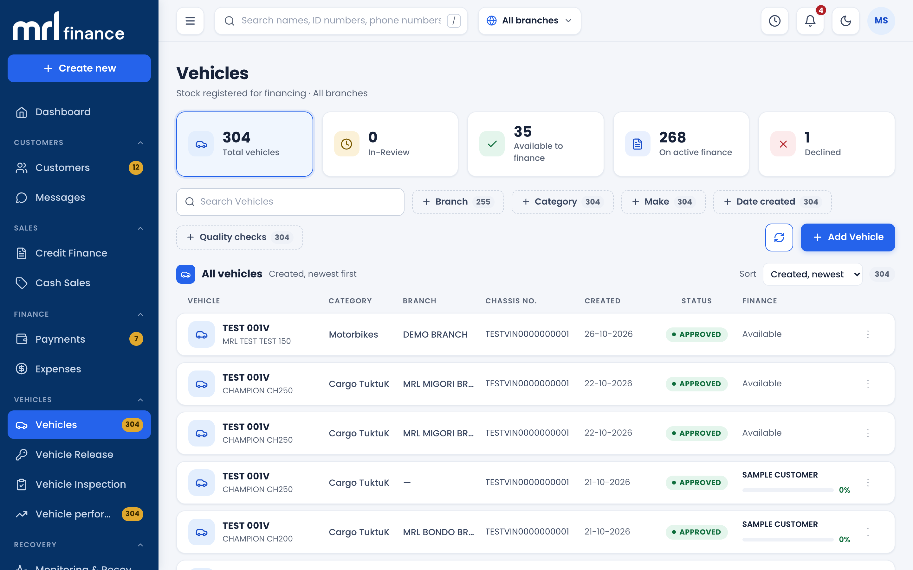
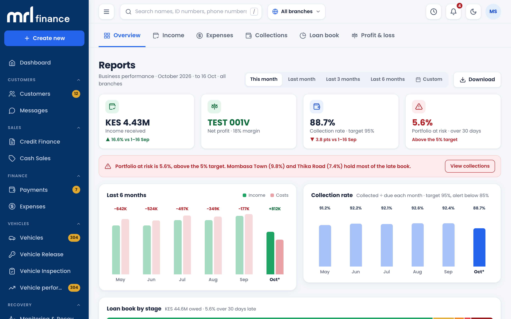

  

  
  
  

---

# Hi there! I'm Fahad Shabir 👋

### 🚀 Senior Flutter Engineer | Architecting Mobile Excellence

I'm a **Senior Flutter Developer** with **5+ years** of hands-on experience in the mobile ecosystem, specializing in building and deploying high-performance, scalable applications for **Android** and **iOS**. My passion is transforming complex business needs into clean, user-centric mobile solutions using **Dart** and the **Flutter framework**.

I thrive on **API integration**, **performance optimization**, and leading development efforts to deliver production-ready apps that genuinely solve problems for users worldwide.

I also build full-stack web applications.

---

## Full-stack web apps

### MemberFlo

A membership CRM for customers, plans, invoices, staff, and revenue.

`Next.js` · `TypeScript` · `TanStack Query` · `Supabase` · `PostgreSQL` · `Stripe`

  
  
  
  
  

### MRL Finance

Vehicle-finance admin for customers, credit, payments, vehicles, and reports.

`Next.js` · `TypeScript` · `React`

  
  
  
  
  

---

## 🛠️ My Expert Toolkit

| Category | Skills & Tools |
| :--- | :--- |
| **Framework & Language** | `Flutter` • `Dart` 💙 |
| **Secondary** | `Java` • `JavaFX` • `Java Android` • `Java Swing` • `Python` • `Flask` |
| **State Management** | `Bloc Cubit` • `GetX` • `Provider` ✨ |
| **Web** | `Next.js` • `TypeScript` • `Supabase` • `PostgreSQL` • `Stripe` |
| **Backend & Cloud** | `Firebase Auth` • `Rest API's Integration` ☁️ |
| **App Capabilities** | `Push Notification` • `Google Maps` • `Localisation` 🌐 |
| **Monetization** | `InApp purchases/Subscription` • `AdMob Integration` 💰 |
| **Deployment** | `Xcode/Appstore publishing` • `Play Console` 🚀 |

---

## 💼 Career Highlights

* **Senior Flutter Engineer** | CloudLaunch (London, UK - REMOTE)
    * Developing and maintaining core mobile and **Flutter web applications**, focusing on robust performance and scalability.
* **Part Time Mobile Developer & Maintainer** | Happy Helpers LLC (Dubai, UAE - REMOTE)
    * **Built the Happy Helpers app from scratch** and managed its full lifecycle, including feature development and team mentorship.
* *Expertise:* Strong proficiency in leading teams, mentoring junior developers, and ensuring superior code quality.

---

## 🌐 My Portfolio: 23+ Published Applications

I have successfully developed and launched **23+ production applications** across Android, iOS, and Flutter Web, covering HRM, FinTech, E-commerce, Education, Healthcare & Fitness, Business Management, Productivity, Utilities, and more.

---

### 🏢 HR, Business & Enterprise Applications

| # | App Name | Description | Links |
| :--- | :--- | :--- | :--- |
| **1** | **YouFirst HRMS** | Enterprise HR management app featuring facial-recognition and location-based attendance, payslips, employee requests, company announcements, and employee communication. | [Play Store](https://play.google.com/store/apps/details?id=com.jmmtech.hrmemployee.hrm_employee) |
| **2** | **HR-Hysabat** | Human Resource Management application for managing employee data, attendance, payroll, and other HR operations. | [Play Store](https://play.google.com/store/apps/details?id=com.jmmtechnologies.hrm&hl=en&gl=US) |
| **3** | **Isnaad WMS** | Warehouse Management System for inventory management, order processing, shipping, and related business operations. | [Play Store](https://play.google.com/store/apps/details?id=com.isnaad&hl=en&gl=US) • [App Store](https://apps.apple.com/pk/app/isnaad/id1638320059) |
| **4** | **KIU – Student** | Student Information System for course registration, grades, academic updates, and student-related university services. | [Play Store](https://play.google.com/store/apps/details?id=com.kiu.sis_student_faculty&hl=en&gl=US) |
| **5** | **KIU – Executive** | University management application covering finances, admissions, academics, schedules, course materials, grades, and exams. | [Play Store](https://play.google.com/store/apps/details?id=com.jmmtechnologies.kiu_sis_ex_fi_sp&hl=en&gl=US) |

---

### 🛒 E-Commerce, POS & Delivery

| # | App Name | Description | Links |
| :--- | :--- | :--- | :--- |
| **6** | **Tojjar Ecommerce** | Wholesale e-commerce platform for browsing products, categories, ordering, and secure payments. | [App Store](https://apps.apple.com/pk/app/tojjar-ecommerce-application/id6450448843) |
| **7** | **Tojjar Delivery App** | Multi-portal application for delivery agents and sales agents to manage deliveries, customers, and merchant registration. | [App Store](https://apps.apple.com/pk/app/tojjar-delivery-application/id6450411233) |
| **8** | **AlRawdh** | Online cosmetics shopping application featuring skincare, makeup, haircare products, and fragrances. | [App Store](https://apps.apple.com/pk/app/alrawdh/id6446835257) |
| **9** | **Happy Helpers** | Service marketplace application offering housekeeping, babysitting, nanny, event, and bespoke support services. | [Play Store](https://play.google.com/store/apps/details?id=com.happyhelper.app) |
| **10** | **Kejabii – Sell Online & In Store** | All-in-one business platform combining online store, mobile POS, inventory management, order tracking, payments, sales reporting, and business management. | [Google Play](https://play.google.com/store/apps/details?id=com.cloudlaunch.kejabii) • [App Store](https://apps.apple.com/us/app/kejabii-online-store-pos/id6773234875) |

---

### 💰 FinTech & Financial Applications

| # | App Name | Description | Links |
| :--- | :--- | :--- | :--- |
| **11** | **C-Exchange – Buy & Sell Crypto** | Cryptocurrency platform focused on secure and reliable crypto buying and selling services. | [Play Store](https://play.google.com/store/apps/details?id=com.cexchange.app&hl=en&gl=US) |
| **12** | **MRL Finance – Admin** | Financial back-office application for customer onboarding, KYC, vehicle approvals, credit agreements, repayment schedules, payment collection, and operational reporting. | [Google Play](https://play.google.com/store/apps/details?id=com.cloudlaunch.mrl) |
| **13** | **MRL Finance – Customer** | Customer financing application for viewing repayment schedules, vehicle financing details, statements, referrals, and M-Pesa STK Push payments. | [Google Play](https://play.google.com/store/apps/details?id=com.cloudlaunch.mrl.customer) |

---

### 📚 Education & Learning

| # | App Name | Description | Links |
| :--- | :--- | :--- | :--- |
| **14** | **Path to Arabic – Flutter Web** | Arabic learning web platform providing Arabic courses, video classes, and Quran-focused language learning. | [Web App](https://member.pathtoarabic.com/) |
| **15** | **Path to Arabic – Mobile App** | Arabic learning mobile application with structured lessons, video tutorials, practice activities, progress tracking, and live tutor support. | [Google Play](https://play.google.com/store/apps/details?id=com.path.to.arabic) • [App Store](https://apps.apple.com/us/app/path-to-arabic/id6741145209) |

---

### 🧠 Productivity, Resume & Utility Applications

| # | App Name | Description | Links |
| :--- | :--- | :--- | :--- |
| **16** | **CV Maker – AI Resume Builder** | AI-powered resume builder for creating professional CVs using customizable templates. | *Missing* |
| **17** | **Smart Resume Builder** | Resume creation utility offering multiple templates and customization options for creating professional resumes. | [Play Store](https://play.google.com/store/apps/details?id=com.resumebuilder.cvmaker.cvtemplate.resumetemplate&hl=en&gl=US) |
| **18** | **Password Manager** | Secure password management application featuring password storage, password generation, and autofill capabilities. | [Play Store](https://play.google.com/store/apps/details?id=com.autopasswordmanager.lastpasswordsaver&hl=en&gl=US) |
| **19** | **Language Translator All** | Translation application supporting text, documents, and image-based translation across multiple languages. | [Play Store](https://play.google.com/store/apps/details?id=com.languagetranslator.englishtranslator.imagetranslator) • [App Store](https://apps.apple.com/pk/app/language-translator-all/id6503053255) |
| **20** | **Hijria** | Islamic calendar application displaying Hijri dates, Islamic events, and important religious dates. | [Play Store](https://play.google.com/store/apps/details?id=com.jmmtechnologies.hijricalendar&hl=en&gl=US) • [App Store](https://apps.apple.com/pk/app/hijria/id1623978880) |

---

### 🏋️ Fitness & Lifestyle

| # | App Name | Description | Links |
| :--- | :--- | :--- | :--- |
| **21** | **Jawline – Face Exercise & Mewing** | Fitness application focused on jawline enhancement through guided exercises and mewing techniques. | [Google Play](https://play.google.com/store/apps/details?id=com.jawline.exercise.mewing.jawlineworkout&hl=en&gl=US) • [App Store](https://apps.apple.com/pk/app/jawline-face-exercise-mewing/id6478913365) |
| **22** | **Marconni Tennis** | Tennis academy status application that informs users whether tennis lessons are currently on or off. | [Play Store](https://play.google.com/store/apps/details?id=com.status.tennis&hl=en&gl=US) |

---

### 🎬 Media & Video Utilities

| # | App Name | Description | Links |
| :--- | :--- | :--- | :--- |
| **23** | **Snack Video Downloader** | Video downloading utility designed for downloading social video content in HD quality. | *Missing* |

---

### 🚀 Additional Project Experience

Beyond the projects listed above, I have worked across multiple production applications involving:

- 📱 Android & iOS development
- 🌐 Flutter Web
- 🔐 Authentication & security
- 💳 Payment integrations
- 💰 In-App Purchases & Subscriptions
- 📍 Google Maps & location services
- 🔔 Push Notifications
- 📊 Analytics
- 📦 Inventory & warehouse management
- 🛒 E-commerce & POS
- 👥 HRM & employee management
- 💵 FinTech & payment systems
- 🎓 Education platforms
- 🤖 AI-powered applications
- 🌍 Multi-language & localization
- 🚀 Google Play & App Store deployment

---

## 📈 My GitHub Stats

  
  

 

  

